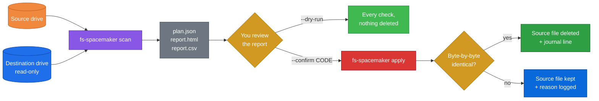

# FS SpaceMaker


Frees disk space **without ever losing unique data**. The program deletes from a **source** drive the files
that have an identical copy on a **destination** drive. The destination is never modified.

> [!IMPORTANT]
> Nothing is ever deleted by `scan`. Only `apply`, given the **confirmation code** of a reviewed plan,
> deletes files, and only after re-checking each one byte by byte against its copy.

- **Source**: the drive or folder to free. Only files whose duplicate is proven are deleted there.
- **Destination**: the drive or folder to keep intact. Nothing is written, moved or deleted there.
- **Residual**: what remains on the source after processing. It is left untouched, but it is measured and
  reported so you can evaluate it before moving it yourself.

The work is split into two separate commands:

| Step | Command | Effect on the drives |
|---|---|---|
| 1. Pre-processing | `fs-spacemaker scan ...` | **None.** Inventory, fingerprints, plan, HTML + CSV report. |
| 2. Processing | `fs-spacemaker apply --plan ... --confirm CODE` | Deletes source duplicates, after re-verification. |

In between, you read the report. The `apply` command refuses to start without the **confirmation code** of
the plan you reviewed.



---

## 1. Installation

Requirement: [Rust](https://rustup.rs) (stable). Works on Windows, macOS and Linux.

```powershell
cd "S:\dev\Legal\FS SpaceMaker"
cargo build --release
# Executable: target\release\fs-spacemaker.exe (a single file, no dependencies)
```

You can copy `fs-spacemaker.exe` anywhere. Its data lives next to it, in the **installation folder**:
the folder of the executable, or the project folder (`S:\dev\Legal\FS SpaceMaker`) when the program runs
from cargo's `target\release`.

```text
<installation folder>\
  reports\       plan, reports and journals (what you read)
  fs-spacemaker-work\
    index.sqlite fingerprint cache (kept, makes later scans fast)
```

The tool is meant for one-off use, so `reports\` keeps **a single set of outputs**, replaced each time:

```text
reports\
  plan.json, report.html, report.csv    replaced by each scan
  dry-run-report.html/.csv, dry-run-journal.csv   replaced by each dry run
  apply-report.html/.csv                result of the last real processing
  apply-journal.csv                     every real deletion ever made: never removed, only appended to
```

A new scan removes the previous outputs (only these exact file names, never anything else), **except
`apply-journal.csv`**: the trace of every deleted file survives later scans. Each run opens with a
`run-started` line naming the plan identifier and both roots.

---

## 2. Step-by-step usage

### Guided run (all steps in one command)

`run-spacemaker.cmd`, at the project root, chains the four steps below: it builds the executable when a
source file changed, scans, opens `report.html`, runs the dry run after you agree, then deletes only once
you type the plan's confirmation code (Enter stops without deleting anything).

**Double-click `run-spacemaker.cmd`** in File Explorer: it asks for the source and destination folders
(type or paste them; Explorer's **Copy as path** quotes are accepted, and `S:` becomes `S:\`). The next
time, it offers the last folders used: press Enter to keep them. Or give both folders directly:

```powershell
.\run-spacemaker.cmd S:\Fin S:\Finance
```

Settings you always want (for example `remove_svn_metadata` or `ignored_stream_names`) belong in
`fs-spacemaker.config.json` (section 6), so no option needs to be typed. The last folders are saved in
`run-spacemaker.last.json` (not versioned).

The launcher calls `run-spacemaker.ps1` without changing the PowerShell execution policy. It also accepts
the options of `scan`: `-Mode`, `-Config`, `-ReportsDir`, `-WorkDir`, `-Threads`,
`-IgnoreStream`, `-IncludeEmptyFiles`, `-DeleteReadOnly`, `-RemoveSvnMetadata`, plus `-NoBuild` (use the
existing build) and `-NoOpen` (do not open the reports in the browser).

### Step 1: pre-processing (no modification)

```powershell
fs-spacemaker scan --source J:\ --destination K:\Archive
```

> [!IMPORTANT]
> Write a drive root with its backslash: `S:\`. Without it, `S:` means "the current folder of drive S:"
> (often not its root), so the tool refuses it.

The console shows what would be freed, what would remain and the predicted free space, then the next two
commands, ready to paste in PowerShell (the leading `&` is PowerShell's call operator, required in front
of a quoted program path):

```text
--- Result (nothing deleted) ---
  will be freed:     182344 files, 311.4 GB
  remains on source: 9120 files, 41.7 GB
  source free space: 11.8 GB now -> about 323.2 GB after
  report: ...\reports\report.html
  ...
Review the report, then verify without deleting:
  & "...\fs-spacemaker.exe" apply --plan "...\plan.json" --dry-run
Apply the plan:
  & "...\fs-spacemaker.exe" apply --plan "...\plan.json" --confirm 8bfeeeb3
```

### Step 2: read the report

Open `report.html` in your browser. The page depends on nothing external and works offline. See section 5.

### Step 3 (recommended): dry run

```powershell
fs-spacemaker apply --plan "...\plan.json" --dry-run
```

The dry run performs **every** check (including the byte-by-byte comparison) without deleting anything. It
produces its own report and journal.

> [!TIP]
> Always run the dry run first: it shows exactly which planned deletions would be skipped (file in use,
> changed since the scan, etc.) before anything is touched.

### Step 4: processing

```powershell
fs-spacemaker apply --plan "...\plan.json" --confirm 8bfeeeb3
```

> [!WARNING]
> Deletions are permanent (the Recycle Bin is not used, so space is freed immediately). Apply only a plan
> whose report you have reviewed; the confirmation code ties the command to that exact plan.

Processing writes, next to the plan:
- `apply-journal.csv`: every decision (deleted, skipped, failed), written to disk **as it happens**, and
  kept across later scans.
- `apply-report.html` and `apply-report.csv`: the **measured** result. The source is re-inventoried after
  processing.

A dry run writes the same three files with the `dry-run-` prefix.

Exit codes: `0` = success, `1` = nothing was done (error before processing),
`2` = processing finished, but with at least one I/O failure (see the journal).

---

## 3. The matching modes (`--mode`)

| Mode | A source file is deletable if... | Typical use |
|---|---|---|
| `content` (default) | a file with **identical content** exists **anywhere** in the destination, whatever its name or folder | Free the most space, even if the destination was reorganised or renamed |
| `same-path` | the file at the **same relative path** in the destination has identical content | A destination that mirrors the source |
| `relocated` | its **whole folder** (same names, same structure, identical contents) exists **elsewhere** in the destination, even under another folder name | Find moved or renamed trees (e.g. `Projects\Alpha` → `Backup\2021\Alpha-final`) |

Notes on `relocated` mode:
- The destination may hold **extra** files in the matching folder. The source folder, however, must be
  **complete** there.
- The top folder may have another name, but its **subfolders and files** must have the same names.
- A file that has an identical copy, but whose folder is not complete elsewhere, stays on the source with
  the reason `tree-incomplete`. `content` mode would delete it.
- The report's **Relocated folders** tab lists every source → destination folder match.

Names are compared case-insensitively on Windows and macOS, and case-sensitively on Linux.

### Merge mode: empty the source completely

`--mode merge` is different from the three modes above: it does not only delete, it **moves**, so that
**the source ends completely empty**.

| A source file... | What happens |
|---|---|
| has a destination file with the **same name and the same size**, anywhere in the destination | **deleted** from the source |
| has no such file | **moved** into the destination, at the **same relative path** |

```powershell
fs-spacemaker scan --source S:\Fin --destination S:\Finance --mode merge
```

> [!WARNING]
> Merge mode compares **file names and sizes only, never the content**. If `notes.txt` (120 bytes) of
> the source differs from a destination `notes.txt` of 120 bytes, the source file is **deleted** anyway.
> Review the **Will be deleted** tab before applying. The other modes compare content byte by byte.

What merge mode guarantees:
- **Nothing in the destination is ever replaced.** When the path is taken (a file of the same name but
  another size, or a folder), the moved file gets a number: `report.pdf` becomes `report (2).pdf`. A
  source folder whose name is taken by a destination *file* is renamed the same way, with everything in it.
  The **Will be moved** tab shows each target path.
- **On the same drive**, a move is an instant rename (no copy, no space used, no space freed).
- **Between two drives**, the file is copied under a temporary name (`.fs-spacemaker-partial`), the copy
  is compared **byte by byte** with the locked source, it takes its final name, and only then is the source
  deleted. Modification time, attributes and NTFS hidden streams are kept.
- Files are paired without being read, so the scan is fast (no fingerprint).
- **Read-only** files are moved, not deleted (unless `delete_read_only` is on), so they are never lost.
- After the moves, **every empty source folder** is removed, including folders that were already empty.

What can stay in the source (shown in the apply report): a file in use or changed since the scan, a file
you may not delete, a destination path taken since the scan (never replaced), and what the tool never
touches: links and junctions, cloud placeholders, excluded names (`System Volume Information`, ...), and
version-control folders (`.git`, and `.svn` unless `--remove-svn-metadata`).

### Two folders of the same drive

Source and destination can be two folders of the same drive, as long as neither contains the other:

```powershell
fs-spacemaker scan --source S:\Fin --destination S:\Finance --remove-svn-metadata
```

`S:\Fin` and `S:\Finance` are distinct folders (the comparison is made folder by folder, not on the text
prefix), so this works. As always, only the source (`S:\Fin`) can lose files; the destination
(`S:\Finance`) is opened read-only and never modified. Fingerprints computed by an earlier scan of the
whole drive (`S:\`) are reused.

### Version-control working copies (`.svn`, `.git`, `.hg`, `.bzr`)

These metadata folders are **never compared or deleted file by file**: deleting part of one would corrupt
its working copy, and a destination's metadata holds internal copies (Subversion "pristine" files) that
must never count as the copy justifying a deletion. They appear in the **Skipped** tab with their size;
for Subversion the report also shows the **repository URL** and the number of **uncommitted local
changes**, read from `wc.db` without writing to it.

| Kind | What happens |
|---|---|
| Subversion (`.svn`, `_svn`) | Kept by default. With `--remove-svn-metadata` (or `remove_svn_metadata`), it is removed **only** once every file of its working copy has been deleted after verification. This is checked again on disk at apply time: one remaining file, even created after the scan, keeps it. The history stays on the Subversion server. |
| Git, Mercurial, Bazaar | **Never deleted**: the folder holds the whole history of the project. |

> [!WARNING]
> Uncommitted local changes (additions, deletions) recorded in `.svn` are lost with it. Their files are
> safe (each one was verified identical on the destination), but the Subversion state is not. If the
> server matters to you, commit first, or keep the metadata.

---

## 4. How two files are proven identical

This is the most reliable **and** the fastest method: only what can match is read, and identity is proven
again before every deletion.

**During the scan**, identity is established through three successive filters:

1. **Size (plus name or path, depending on the mode).** No file is read at this stage. A file whose size
   does not exist on the other side is ruled out immediately.
2. **Partial fingerprint.** The BLAKE3 digest of the first 64 KB quickly rules out files of the same size
   but different content.
3. **Full fingerprint.** The BLAKE3 digest of the whole file, a 256-bit cryptographic fingerprint.

**During `apply`, right before each deletion** (these checks are always redone):

1. The source still exists with the **same size and date** as at scan time, and is neither a link nor an
   online-only file.
2. The destination copy exists with the same size and is not a link.
3. Source and destination are **not the same physical file** (hard link, junction, mount point).
4. Read-only files are protected unless `delete_read_only` is enabled.
5. **Windows:** every hidden NTFS stream of the source (ADS, see section 4b) also exists, byte-identical,
   on the destination copy.
6. **Windows:** both files are then **locked**: from that moment until the deletion, no other program can
   write, rename or delete the source or the destination copy (readers are still allowed). Size, date and
   type are checked again **on the locked files themselves**.
7. Both files are **compared byte by byte**, in full, which removes even the theoretical risk of a
   fingerprint collision.
8. The fingerprint of the content read must be **the one from the scan**. If the source changed in the
   meantime, it is left alone.
9. **Windows:** the source is deleted **through the very handle that was verified**, so even a file
   swapped under the same name at the last instant could not be deleted in its place.

> [!CAUTION]
> At the slightest discrepancy, the file is **skipped** (left in place) and the reason is logged. When in
> doubt, the program always keeps the data.

```diff
+ identical size, date, content and fingerprint  -> source file deleted
- any difference, file in use, link, hidden data -> source file kept, reason logged
```

### Why not Windows Search indexing?

The Windows index computes no content fingerprint, can be incomplete (excluded folders, system files,
out-of-date index) and exists only on Windows. It therefore **cannot** prove that two files are identical.
FS SpaceMaker has its **own index** (`fs-spacemaker-work\index.sqlite`, in SQLite):

- For each file read, it keeps the size, date and fingerprints, keyed by **absolute path**: a scan of
  `S:\Finance` reuses what a scan of `S:\` computed.
- On the next scan, a file whose size and date have not changed **is not read again**. That is why a second
  scan is nearly instantaneous.
- Fingerprints are saved **in batches during the scan** (every 20,000 files or 8 GB read): an interrupted
  scan (Ctrl+C, reboot) resumes where it stopped.
- Entries of files that no longer exist are removed at each scan, so the index does not keep growing.
- Only files whose size exists on both sides are read. Indexing everything would be pointless.
- The index only **speeds up planning**. It never authorises a deletion, since `apply` always re-compares
  the bytes.

### What is never touched

- **Symbolic links and junctions**: never followed, never deleted, on either side.
- **OneDrive online-only files**: skipped. Reading them would start a download, and they free no local space.
- **Files whose name is not valid Unicode**, and special files.
- **`System Volume Information`, `pagefile.sys`, `hiberfil.sys`, `swapfile.sys`**: excluded (configurable
  list).
- **Trash folders** (`$RECYCLE.BIN`, `RECYCLER`, Linux `.Trash-*`, macOS `.Trashes`): excluded on both sides,
  so a file whose only other copy sits in a trash (which gets emptied one day) is never deleted.
- **Version-control metadata** (`.svn`, `.git`, ...): see section 3.
- **Files you have no right to delete** (protected system files, other owners): detected by the scan
  (`access-denied`) and skipped, never forced.
- **Empty files** in `content` mode: they free nothing and often serve as markers (option
  `include_empty_files`).
- **The destination**: read-only from start to finish.
- **The source root** and **folders that were already empty before processing**.

### Folder safeguards

- Source and destination must be **distinct**, and neither may contain the other. Otherwise, a deletion in
  the source could hit the destination. This check is done on the path text, but also on the **physical
  identity** of the NTFS folders, so the same folder seen through another path is refused too: `subst`
  drive, mapped network drive, `\\machine\C$` share or junction.
- The work folder and the reports folder must not be inside the source.
- At `apply` time, if a folder of the plan is no longer available or resolves somewhere else than at scan
  time (unplugged drive, changed junction), nothing is deleted.
- The plan carries an identifier equal to the BLAKE3 fingerprint of its content. **Any edit to `plan.json`
  makes it invalid.**

---

## 4b. Windows specifics (NTFS)

The program is designed first for Windows and tested on Windows 11, with dedicated tests
(`tests/windows.rs`).

| Windows situation | Behaviour |
|---|---|
| File open or locked by another program (Word, Outlook, antivirus, sync), source **or destination** | Skipped (`skipped-in-use`), never forced. It is not a failure: run `apply` again later. |
| Protected file (`Program Files`, `Windows`, another user's file: "Access is denied") | Predicted by the scan (`access-denied`), skipped at apply time (`skipped-access-denied`). Not a failure. |
| **Alternate data streams (ADS)**, hidden data inside an NTFS file (`file.txt:notes`) | Each stream of the source must also exist, **byte-identical**, on the destination copy; otherwise the file is **protected** (`alternate-streams`). `Zone.Identifier` (the "downloaded from the Internet" mark) is always ignored, and you can declare other metadata streams as ignorable with `ignored_stream_names` / `--ignore-stream` (e.g. `com.dropbox.*`, left by the Dropbox client). |
| OneDrive online-only files | Skipped, so no download is triggered |
| Junctions, symbolic links, mount points | Never followed, never deleted |
| Hidden and system files (`Thumbs.db`, `desktop.ini`) | Handled like any other. `desktop.ini` is often read-only, so protected by default. |
| Read-only attribute | Protected by default. With `delete_read_only`, the file is deleted despite the attribute. |
| Paths longer than 260 characters | Supported (`\\?\` prefix) |
| Special names (`CON`, `NUL`, `AUX`, names ending with a dot or a space) | Supported |
| Name case (`Report.TXT` = `report.txt`) | Ignored, as Windows does |
| `System Volume Information`, `$RECYCLE.BIN`, `pagefile.sys`, `hiberfil.sys` | Excluded |
| Drive root as source (`J:\`), `subst` drive, network path `\\server\share` | Supported |
| Drive-relative path (`S:` without backslash) | Refused, with the corrected form in the message |

> [!TIP]
> Before `apply`, pause OneDrive sync and any backups that touch the source or the destination. A file they
> have open is simply skipped, but you will get more deletions on the first run.

---

## 5. The HTML report

A report is generated at each step: after the scan (**prediction**), after a dry run and after processing
(**measured result**).

- **Before / After** (top): switches the whole page between the current state and the predicted (or
  measured) state after processing. This affects the disk space bars, folder sizes and the folders that
  will disappear (struck through).
- **What happens**: a plain-sentence summary of what will happen, with the processing command and a button
  to copy it.
- **Summary**: what will be freed, what will remain, the predicted free space, whether the residual fits in
  the destination, and skipped or failed items.
- **Disk space**: one bar per volume (used, freed, free).
- **Source folders**: an expandable tree. For each folder: size before or after, space freed, file count
  after and before, and the freed share. You can search a folder by name and filter **fully freed**,
  **partially freed** or **untouched** (100% residual) folders.
- **Largest remaining folders**: where the residual lives, at the chosen depth. This is what to evaluate
  before moving data.
- **Details**: tabs (Will be deleted, Remains on source with the reason, Relocated folders, Skipped,
  Errors). Each tab offers search, filtering by reason, sorting by column and pagination. Hovering a path
  shows the full path.

The HTML keeps the 50,000 largest rows of each table (`report_max_rows`). **`report.csv` always contains
every row.** It is UTF-8 encoded with a BOM and opens directly in Excel. Its columns are:
`category, path, other_path, size_bytes, tag, detail`.

### Residual reasons (`tag`)

| Tag | Meaning |
|---|---|
| `no-candidate` | No destination file of the same size (and same name or path, depending on the mode) |
| `content-differs` | Files of the same size exist, but their content differs |
| `tree-incomplete` | (relocated) An identical copy exists, but not the whole folder |
| `empty-file` | Empty file (content mode) |
| `read-only` | Protected read-only file |
| `same-physical-file` | Source and destination are the same file (hard link) |
| `alternate-streams` | A hidden NTFS stream (ADS) is missing or different on the destination copy, so the file is protected |
| `access-denied` | You have no right to delete this file (protected system file, other owner) |
| `unreadable` | The file could not be read (often: locked by another program) |

### Processing statuses (`apply-journal.csv` and `apply-report.html`)

| | Status | Meaning |
|---|---|---|
| 🟢 | `deleted` / `would-delete` | Deleted (or would be, in a dry run) after every check |
| 🟡 | `skipped-source-missing` | The source no longer exists |
| 🟡 | `skipped-source-changed` | The source changed since the scan (size, date or content) |
| 🟡 | `skipped-destination-missing` / `skipped-destination-changed` | The copy disappeared or changed |
| 🟡 | `skipped-content-differs` | The byte-by-byte comparison found a difference |
| 🟡 | `skipped-same-file` | Source and destination are the same physical file |
| 🟡 | `skipped-read-only` | Protected read-only file |
| 🟡 | `skipped-alternate-streams` | A hidden NTFS stream is missing or different on the destination copy |
| 🟡 | `skipped-in-use` | File open or locked by another program (source or destination copy) |
| 🟡 | `skipped-access-denied` | No right to delete this file (protected system file, other owner) |
| 🟡 | `skipped-cloud-placeholder` | The file became online-only |
| 🔴 | `failed` | Unexpected I/O error (exit code 2). The file is not touched. |
| 🟢 | `deleted-svn-metadata` / `would-delete-svn-metadata` | Subversion metadata removed with its emptied working copy |
| 🟡 | `kept-svn-metadata` | The working copy still holds files: its metadata is kept |
| | `run-started` | First line of each run: plan identifier and roots |

> [!NOTE]
> Any status other than 🟢 `deleted` means **the source file is intact**.

---

## 6. Options and configuration

### Command line

```text
fs-spacemaker scan  --source <folder> --destination <folder>
                    [--mode content|same-path|relocated|merge] [--reports-dir <folder>] [--work-dir <folder>] [--config <file>]
                    [--threads N] [--include-empty-files] [--delete-read-only]
                    [--ignore-stream NAME]... [--remove-svn-metadata]

fs-spacemaker apply --plan <plan.json> (--confirm <code> | --dry-run)
                    [--config <file>] [--threads N]
```

### Configuration file

Copy `fs-spacemaker.config.example.json` as `fs-spacemaker.config.json` **in the installation folder**, or pass
it with `--config`. Every key is optional and unknown keys are rejected, to catch typos. Priority order:
command line > file > defaults.

| Key | Default | Role |
|---|---|---|
| `scan_threads` | CPU count (max 8) | Parallel reads during the scan. Use 1 or 2 for a mechanical hard disk. |
| `apply_threads` | 4 | Parallel verifications during `apply` |
| `partial_hash_bytes` | 65536 | Size of the fingerprint pre-filter |
| `excluded_names` | (see the file) | Names never inventoried, on either side (trailing `*` = prefix, e.g. `.Trash-*`) |
| `report_max_rows` | 50000 | Rows per table in the HTML |
| `include_empty_files` | false | Also delete empty files (content mode) |
| `delete_read_only` | false | Also delete read-only files |
| `remove_emptied_dirs` | true | Remove folders emptied by processing |
| `ignored_stream_names` | `[]` | NTFS stream names holding no user data (trailing `*` = prefix), e.g. `["com.dropbox.*"]` |
| `remove_svn_metadata` | false | Remove Subversion metadata once its whole working copy is deleted (section 3) |
| `reports_dir` | `reports` in the installation folder | Location of the plan, reports and journals |
| `work_dir` | `fs-spacemaker-work` in the installation folder | Location of the fingerprint index |

`delete_read_only`, `remove_emptied_dirs`, `ignored_stream_names` and the Subversion metadata removals are
**frozen into the plan** at scan time, so the report predicts exactly what `apply` will do.

---

## 7. Predicting the freed space

- The prediction adds up the **logical sizes** of the deleted files. The real gain can be slightly smaller
  in three cases: NTFS-compressed files, sparse files, or files that have **other hard links** elsewhere in
  the source (their data stays on disk as long as one link exists).
- The `apply` report shows the **measured** free space before and after.
- The residual is compared with the destination's free space, to know whether it could be moved there.

---

## 8. Tests

**Full verification in one command (Windows):**

```powershell
powershell -ExecutionPolicy Bypass -File .\run-tests.ps1
```

The script runs, in order:
1. the formatting check;
2. static analysis (Clippy, any warning = failure);
3. the 187 tests;
4. the release build;
5. the load test.

It ends with `All checks passed.` or with the list of failed steps.

Individual commands:

```powershell
cargo test                                                  # every suite (187 tests)
cargo test --test windows                                   # Windows-specific tests
cargo test --release --test stress -- --ignored --nocapture # load test (10,000 files)
$env:FS_SPACEMAKER_PROPTEST_CASES = "1000"; cargo test --release --test properties   # long property test
```

> [!NOTE]
> The file symbolic link test only runs in an **elevated** session or with Windows **Developer Mode** on
> (Settings > System > For developers > Developer Mode). Otherwise it is skipped and says so. Junctions are
> always tested.

| Type | File | What is checked |
|---|---|---|
| Unit | `src/*.rs` (`mod tests`) | Paths (rejection of `..`, drives, NTFS streams), BLAKE3 (official test vector), byte-by-byte comparison, SQLite index, configuration, plan (any edit is detected), tree matching, folder aggregation, HTML and CSV escaping |
| Integration | `tests/scan_apply.rs` | The 3 modes, prediction equal to the measured result, large files differing at the last byte, empty files, emptied or already-empty folders, dry run, index reuse, journal kept across scans, Unicode, paths longer than 260 characters, name case |
| Folders | `tests/folders.rs` | Two folders of the same drive with a common name prefix (`Fin` / `Finance`), Subversion working copy removed whole, kept while a file remains or appears after the scan, old format with `.svn` in every folder, destination metadata never used as a copy, Git never deleted, trash folders never used as a copy, fingerprints reused from a parent scan |
| Merge | `tests/merge.rs` | Source left completely empty, same name and size deleted even when the content differs, same name with another size or same size with another name moved, numbered names (`report (3).pdf`), folder blocked by a destination file renamed whole, modification time kept, read-only files moved, dry run, destination path taken after the scan never replaced, source changed after the scan, empty files, applying twice, the real executable, file in use, NTFS hidden streams, **move between two drives** (copy verified byte by byte; runs when `FS_SPACEMAKER_OTHER_VOLUME_DIR` names a folder on another drive than the temporary folder) |
| Safety | `tests/safety.rs` | Nested or identical folders, confirmation code, edited plan, source or destination modified **with the same size and date**, copy deleted between scan and apply, hard link, **junction to the destination**, read-only, unplugged source, applying twice |
| Windows | `tests/windows.rs` | Source open for writing, file locked without delete sharing, locked destination, destination open for writing, file the user may not delete (scan and apply), drive-relative path refused, file locked during the scan, ADS streams (missing, different, copied identically, ignored by pattern, changed after the scan), `Zone.Identifier` accepted, hidden and system files, read-only `desktop.ini`, `CON`/`NUL`/`AUX` names and names ending with a dot or a space, file symbolic link, **destination aliased through `subst`, `\\localhost\C$` and a junction (refused)**, `subst` root and network path used as a normal source |
| Properties | `tests/properties.rs` | Random trees with collisions, in the 3 modes. Checks that the destination is intact, every deleted file had an identical copy, kept files are unchanged, freed space equals the prediction, and nothing deletable is missed (content mode) |
| End-to-end | `tests/cli.rs` | The real executable: scan, dry run, refusal without a code or with a wrong code, apply, exit codes, invalid configuration |
| Load | `tests/stress.rs` | 10,000 files with many size collisions (scan ≈ 1.5 s, apply ≈ 2-3 s) |

---

## 9. Tips for a first use

> [!TIP]
> Treat the first run as a rehearsal: a small subfolder, then a dry run, then the real processing.

1. Start with a **subfolder** of the source to get familiar with the report.
2. Always run the dry run (`--dry-run`) before the real processing.
3. Before `apply`, close programs that write to the source or destination (OneDrive sync, backups, etc.).
   A modified file is skipped, never deleted, in any case.
4. `apply-journal.csv` is your permanent record of deletions: later scans never remove it.
5. On a mechanical hard disk, use `--threads 2` to avoid needless head movement.

## 10. Architecture (for maintenance)

| Module | Role |
|---|---|
| `cli.rs` / `main.rs` | Command line and console output |
| `config.rs` | Defaults, JSON file, validation |
| `platform.rs` | Windows specifics: locks, deletion through the verified handle, delete rights, ADS streams, online-only files, files in use |
| `vcs.rs` | Version-control metadata: recognition, Subversion summary (`wc.db`), removal of emptied working copies |
| `paths.rs` | Canonical roots (`\\?\` prefix for long paths), overlap guard, portable relative paths |
| `inventory.rs` | Walk without following links, online-only file detection |
| `hashing.rs` | Sequential-read BLAKE3, byte-by-byte comparison |
| `index.rs` | SQLite fingerprint index (absolute-path keys, pruning, migration of the old layout) |
| `fingerprint.rs` | Parallel computation of partial and full fingerprints, in batches saved to the index |
| `matching.rs` | The 3 comparison modes: size → partial fingerprint → full fingerprint; merge mode: name + size |
| `targets.rs` | Merge mode: free destination path of each moved file (numbered names, never replacing) |
| `tree_match.rs` | Relocated mode: intersection of candidate folders, from leaves to root |
| `plan.rs` | The frozen plan, its identifier and the confirmation code |
| `scan.rs` | Orchestration of pre-processing and the prediction report |
| `apply.rs` | Checks, deletion, journal, folder cleanup and the result report |
| `report.rs` + `assets/report.html` | Report model, CSV and interactive HTML page |

Language: **Rust**. It gives a single native, cross-platform executable with no garbage collector, parallel
reading (rayon) and SIMD-accelerated BLAKE3 at several GB/s, which leaves the disk as the only bottleneck.
